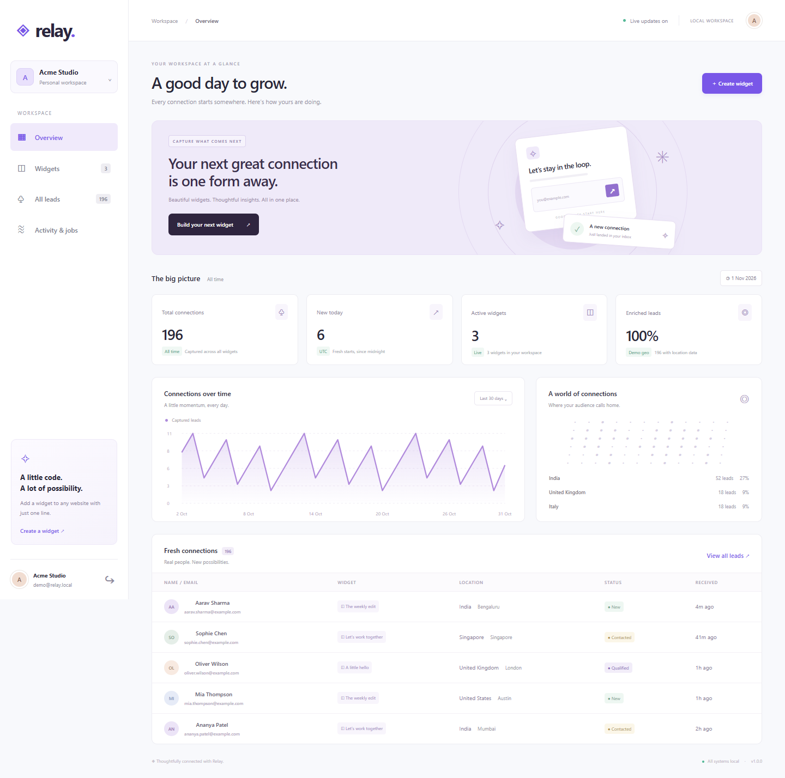
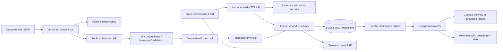

# Relay · Lead capture, connected.

A complete local capstone for an embeddable widget and lead-capture platform. Create a form in the owner dashboard, paste one script tag into another website, and capture validated, spam-filtered, enriched leads. Includes a live dashboard, multi-tenant authentication, SQL migrations, a durable notification outbox, and deterministic acceptance tests.



## Run locally

Install **Node.js 24.11 or newer**. Local mode needs no API keys, credit card, or database service. Install the project dependency (the optional hosted Postgres driver), then run from this project's directory:

```sh
npm ci
npm run seed
npm start
```

Open **http://localhost:4100**. The seed creates fictional demo data and prints a customer-site link. It is safe to repeat and never overwrites an existing demo workspace.

| Demo workspace | Email | Password |
| --- | --- | --- |
| Acme Studio | demo@relay.local | RelayDemo!2026 |
| Other Tenant | other@relay.local | RelayDemo!2026 |

These deliberately public credentials are only for local demonstration. New workspaces can be created from the sign-in screen. All seeded people, emails, geo results, and historical deliveries are fixtures, not real customers or observed delivery history.

In a second terminal, from the same directory:

```sh
npm run demo
```

In Relay, select **Widgets → Get snippet → localhost:5500**. The fictional Fieldnotes customer site loads the widget from port 4100 and posts across origins. Submit a form with consent, then watch the owner dashboard update without a refresh.

Use `localhost` consistently for the owner dashboard. `BASE_URL` determines the allowed owner mutation origin and generated embed origin. If you prefer `127.0.0.1`, set `BASE_URL=http://127.0.0.1:4100` first. For free hosted deployment with persistent Postgres, see [DEPLOYMENT.md](docs/DEPLOYMENT.md) and `render.yaml`. Hosting is prepared but is not yet live.

## What is included

- Signup, contact, and corner-popover widgets; editable field schemas and brand colors; pause/resume and full CRUD.
- Visual form builder with preview, embed snippets, and Shadow DOM style isolation.
- Page-prefix, delayed-display, and once-after-submission targeting.
- Salted scrypt passwords, opaque hashed sessions, HttpOnly cookies, expiry, logout, and owner-origin checks.
- Tenant predicates on owner reads, writes, exports, metrics, notifications, audit records, and live updates.
- Cross-origin public API, preflight, 16 KB body cap, strict validation, clean JSON errors and request IDs.
- Independent IP and widget rate limits, `Retry-After`, honeypot filtering, bounded limiter memory, and trusted-proxy configuration.
- Geo A → B → null fallback with bounded real-provider timeouts and deterministic offline failure toggles.
- Idempotency keys and a SQL uniqueness constraint; concurrent retries produce one lead and one delivery intent.
- Atomic lead + notification job writes; background retries, exponential backoff, dead-letter alerts, and manual owner retries.
- Analytics, searchable/paginated leads, status workflow, consent records, CSV export with formula neutralization, and personal-data deletion.
- Server-Sent Events live refresh, responsive UI, SQL migration tracking, health checks, Docker recipe and CI workflow.

## Architecture



`src/app.js` owns HTTP routing, headers, auth gates and orchestration. `src/security.js` owns boundary rules and password helpers. `src/enrichment.js` owns upstream failure boundaries. `src/repository.js` owns tenant-scoped SQL and transaction boundaries. `src/database.js` applies numbered migrations and configures WAL/foreign keys. `src/jobs.js` owns the background delivery lifecycle. No asynchronous work runs inside a SQL transaction.

See [DESIGN.md](DESIGN.md) for the data model, invariants, and tradeoffs, [docs/API.md](docs/API.md) for request examples, and [docs/openapi.json](docs/openapi.json) for the machine-readable API contract.

## Configuration and deterministic failures

Defaults work without an `.env`. To customize, copy `.env.example` to `.env` (`Copy-Item .env.example .env` in PowerShell), edit, and restart. Every supported environment setting is documented in the example.

| Setting | Behavior |
| --- | --- |
| `GEO_MODE=mock` | Offline mock A returns Bengaluru; mock B returns Mumbai. Dashboard labels demo geo. |
| `MOCK_GEO_A_DOWN=true` | Next new submission falls back to mock B. |
| `MOCK_GEO_A_DOWN=true` and `MOCK_GEO_B_DOWN=true` | Submissions still return 201 with `geo: null`. |
| `GEO_MODE=live` | Uses ip-api, then ipapi, with 1.8-second timeouts per provider. Private/loopback IPs skip lookup. |
| `NOTIFICATION_MODE=fail` | Background delivery fails; lead acceptance still succeeds. After 3 attempts the job dead-letters. |
| `NOTIFICATION_MODE=console` | Logs a delivery event containing only the job ID. No email is actually sent. |
| `TRUST_PROXY_HOPS=0` | Ignores forwarded IP headers. Change only behind the exact trusted proxy topology. |
| `COOKIE_SECURE=true` | Use when serving the owner dashboard over HTTPS. |

Live providers are optional external dependencies. The [ip-api JSON documentation](https://ip-api.com/docs/api:json) documents its HTTP free endpoint and rate limits. This endpoint discloses the visitor IP over unencrypted transport; use mock mode for the local demo. [ipapi documentation](https://ipapi.co/api/) describes the HTTPS fallback. Provider quotas or outages never prevent a valid lead from being stored. Raw IPs are not persisted or logged by Relay.

## Verification and evidence

```sh
npm test
npm run evidence
```

Tests use isolated temporary database files and real local HTTP servers. They never touch your application database or external geo providers. `npm run evidence` runs the tests and writes the real test output plus a requirement-by-requirement mapping into `EVIDENCE.md` and `docs/evidence/`.

Optional browser verification requires Playwright: install it locally with `npm install --no-save playwright`, then `npx playwright install chromium`, and run `node scripts/browser-check.js`. Close any application already using ports 4100/5500 first. It creates its own temporary demo database, checks real cross-origin submission and automatic SSE updates, tests a 390px viewport, and records screenshots. It does not modify your regular database.

The supplied [browser result](docs/evidence/browser-results.json) and screenshots record the verification actually performed. [EVIDENCE.md](EVIDENCE.md) maps acceptance criteria to tests. A supplied CI workflow is not a claim that GitHub Actions has run.

## Docker alternative

```sh
docker compose up --build -d
docker compose exec relay node scripts/seed.js
```

Then open http://localhost:4100. Run `npm run demo` on the host for the separate customer origin. `docker compose exec relay npm test` runs the API suite inside the container. The service runs as a non-root user and persists SQLite in a named volume. `docker compose down` retains data; `docker compose down -v` deliberately deletes it.

The Docker configuration has been statically checked. Local container build/runtime verification is outstanding because the Docker Desktop Linux engine was not running during this build. Native Node verification is recorded separately.

## Submission and repository

This folder is self-contained and does not import code or packages from the surrounding assignments workspace. **Before publishing, copy this folder into its own standalone repository named `flyrank-capstone-widget-platform`.** The assignment calls for a dedicated public repository; the existing assignments repository should not be used for capstone submission.

The dedicated public repository is [Soham334/flyrank-capstone-widget-platform](https://github.com/Soham334/flyrank-capstone-widget-platform). No portal submission or historical phase commits have been created. The requirement to have a public repository from day one cannot be retroactively met by inventing commit history. Keep an honest history from your next working session and review the implementation before submission. Submit the repository URL through the portal, not an archive.

Required submission files are present: README, `capstone.yaml`, `EVIDENCE.md`, `BUILDLOG.md`, `.env.example`, and LICENSE. The design and [presentation guide](docs/DEMO-GUIDE.md) help you explain the engineering choices.

## Limitations

This is an advanced **single-process local capstone**, not a horizontally scaled production service. SQLite writes and dashboard aggregates are synchronous. Rate buckets and SSE connections live in process memory and reset on restart. Run one application process per database; the queue is not a distributed worker lease system. Sessions persist, but live connections reconnect after restarts. Scaling requires a shared rate store, a broker, Postgres, and transactional worker leases.

Notification dispatch is a console adapter, not SMTP. Delivery jobs have at-least-once semantics after a crash; a real downstream provider must deduplicate on the stable job ID. Submissions have idempotent acceptance while their records exist. Deleting a lead removes its deduplication key and notification records. Public config can remain cached for 30 seconds after an edit; submissions immediately check current active state. The v1 script filename must change whenever its contents change after release.

Consent records and export/delete tools are engineering features, not a claim of legal compliance. Double opt-in, account recovery, email verification, account deletion, retention automation, CAPTCHA, allowed-origin restrictions per widget, global distributed abuse defense, and production incident monitoring are outside this implementation. CSV exports cap at 10,000 rows; jobs and audit views show the latest 100 records. Dates are stored in UTC; the “today” metric uses UTC. No runtime AI calls or AI billing exist.
